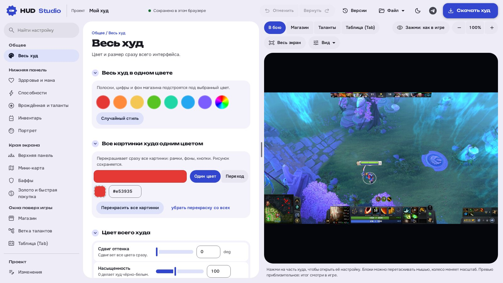

<div align="center">


# HUD Studio — Dota 2 HUD Editor

**Build your own Dota 2 HUD in the browser: live preview, no install, a ready-to-use mod in one click.**

[**Open the editor →**](https://vpkgod.github.io/dota-hud-studio/)

[](https://vpkgod.github.io/dota-hud-studio/)
[](https://vpkgod.github.io/dota-hud-studio/)
[](https://t.me/vpkdota)

English · [Русский](README.ru.md)



</div>

## What it is

HUD Studio is a free web editor for the **Dota 2 HUD** (the in-game interface). Change colors, images, sizes and positions of every HUD block — health and mana bars, abilities, inventory, portrait, top bar, minimap, shop, talent tree, scoreboard — and see the result right away in a preview built from the game's own layout, styles, fonts and images.

When you are done, the site builds a real Dota 2 mod file (`pakNN_dir.vpk`) **inside your browser**. There is no server, no account and nothing to install.

> The interface of the site is currently in Russian. Everything is visual, so it is easy to follow anyway.

## Features

- **Live preview** that looks like the real game: in-battle HUD, shop with tabs, talent tree (hover and pinned modes), scoreboard.
- **Click to edit** — click any part of the HUD in the preview to open its settings. Drag blocks with the mouse, zoom with the wheel.
- **Whole-HUD tools** — recolor the entire HUD with one color or a gradient, shift hue, change saturation.
- **Your own images** — upload pictures for frames, backgrounds and buttons.
- **Undo / redo, versions and project files** — snapshots of your HUD, export/import a project to move it to another computer.
- **Private by design** — your project is stored only in your browser (localStorage + IndexedDB).
- **Light and dark theme** for the editor itself.

## How to use

1. Open **[vpkgod.github.io/dota-hud-studio](https://vpkgod.github.io/dota-hud-studio/)**.
2. Pick a HUD section on the left (or click a part of the HUD in the preview).
3. Change settings in the middle panel. Changed values are highlighted, and each has a reset button.
4. Press **Download HUD** («Скачать худ»), choose your game language and a file number (default `80`).
5. In Steam: right-click Dota 2 → **Manage → Browse local files**.
6. Put the downloaded `pak80_dir.vpk` into `game/dota_<language>` (for example `game/dota_english`). Create the folder if it does not exist. Do not rename the file.
7. Restart Dota 2.

To remove the mod, delete the file and restart the game.

## FAQ

**Is it safe? Can I get banned?**
The mod only changes the look of the interface (Panorama styles and images). It does not touch game logic or memory. Cosmetic HUD mods of this kind have been used for years, but any mod is used at your own risk.

**The mod stopped working after a Dota update.**
The mod contains a copy of the game's styles plus your rules. After a big patch, wait until the site is updated for the new game version, then download your HUD once more — your project is still saved in the browser.

**The preview and the game look slightly different.**
The preview is a close approximation built from the game's CSS numbers, not the Panorama engine itself. Always check the final result in the game.

## How it works

- `docs/` is the whole website — plain HTML, CSS and JavaScript with no build step and no npm. It is served by GitHub Pages.
- The mod is assembled by `docs/js/build/`: it takes the game's original style sheets, appends the generated rules, encodes the compiled Source 2 resources (`vcss_c`, `vtex_c`) and packs them into a VPK archive — all client-side.
- The compiled style files were checked against the output of Valve's `resourcecompiler`.
- Python (`hudstudio/`) is used only to prepare data: the settings catalog and game files extracted from an installed Dota 2.

## Development

```bash
./run.sh                                      # serve the site at http://127.0.0.1:8770
python3 -m unittest discover -s tests -t .    # settings catalog tests
./tests/run_js.sh                             # mod builder tests (needs Node; pulled via nix on NixOS)
./update.sh                                   # refresh game files after a Dota 2 update
```

- `python3 -m hudstudio.export` regenerates `docs/data`, `docs/game` and `docs/gamecss` from the installed game. Do not edit these folders by hand.
- `update.sh` needs an installed Dota 2 and `Source2Viewer-CLI`. Paths can be changed with `HUDSTUDIO_DOTA` and `HUDSTUDIO_DECOMPILER` (see `hudstudio/config.py`).
- A new setting = an entry in `hudstudio/cat_*.py` + a `--setting-id` variable in `docs/styles/preview.css`. CSS rules are generated in two places (`hudstudio/cssgen.py` and `docs/js/build/cssgen.js`), kept in sync by `tests/js/parity.test.mjs`.

Issues and pull requests are welcome.

## Credits and legal

- Dota 2, its HUD images and the Radiance / Reaver fonts used in the preview are property of **Valve Corporation**. This project is a fan-made tool and is not affiliated with or endorsed by Valve.
- Icons: [Material Symbols](https://fonts.google.com/icons) by Google, Apache License 2.0 (`docs/img/ICONS-LICENSE.txt`). Telegram logo from [Simple Icons](https://simpleicons.org/) (CC0).
- Fonts of the editor UI: Unbounded and Onest (SIL Open Font License).

Made by [vpkgod](https://github.com/vpkgod) · news and updates: [t.me/vpkdota](https://t.me/vpkdota)
