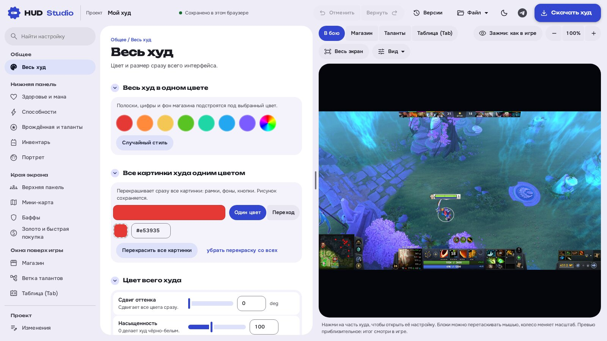

# HUD Studio — редактор худа Dota 2

[English](README.md) · Русский

**Сайт: https://vpkgod.github.io/dota-hud-studio/**

Сайт-редактор своего худа для Dota 2. Меняешь цвета, картинки, размеры и положение блоков, сразу видишь результат и скачиваешь готовый файл мода. Всё работает прямо в браузере: ни сервера, ни установки, ни регистрации. Сайт на русском и английском, переключатель RU / EN в верхней строке.

## Как пользоваться

1. Слева выбери раздел худа (или нажми на нужную часть в превью справа).
2. Меняй настройки в панели посередине. Изменённое помечено жёлтым, рядом кнопка возврата.
3. Нажми «Скачать худ», выбери язык игры и номер файла (по умолчанию 80).
4. В Steam: правой кнопкой по Dota 2 → «Управление» → «Просмотреть локальные файлы».
5. Положи файл `pak80_dir.vpk` в папку `game/dota_russian` (для английской игры — `game/dota_english`). Если папки нет, создай. Имя файла не меняй.
6. Перезапусти Dota 2.

Если худ не появился — игра не подключила папку языка. В Steam: Dota 2 → «Свойства» → «Параметры запуска», допиши `-language russian` (или свой язык) и перезапусти игру.

Чтобы убрать мод, удали файл и перезапусти игру. Работа сохраняется в браузере сама. «Версии» хранят снимки худа, «Файл» переносит проект на другой компьютер.

## После обновления Dota 2

Сайт дописывает свои правила в конец стилей игры, поэтому стили должны быть свежими. После обновления игры запусти `./update.sh` и отправь изменения на GitHub. Нужны установленная Dota 2 и `Source2Viewer-CLI`.

## Для разработки

- `./run.sh` — открыть сайт на своём компьютере (http://127.0.0.1:8770).
- `python3 -m unittest discover -s tests -t .` — проверки каталога настроек.
- `./tests/run_js.sh` — проверки сборщика мода (нужен Node; на NixOS берётся сам через nix).
- Папка `docs/` — это и есть сайт. `docs/data`, `docs/game` и `docs/gamecss` создаёт `python3 -m hudstudio.export`.

Пути к игре меняются переменными `HUDSTUDIO_DOTA`, `HUDSTUDIO_DECOMPILER` (см. `hudstudio/config.py`).

## Права

Dota 2, картинки худа и шрифты Radiance / Reaver принадлежат Valve. Это фанатский инструмент, он не связан с Valve. Иконки — Material Symbols (Google, Apache 2.0), логотип Telegram — Simple Icons (CC0).

Новости и обновления: [t.me/vpkdota](https://t.me/vpkdota)
